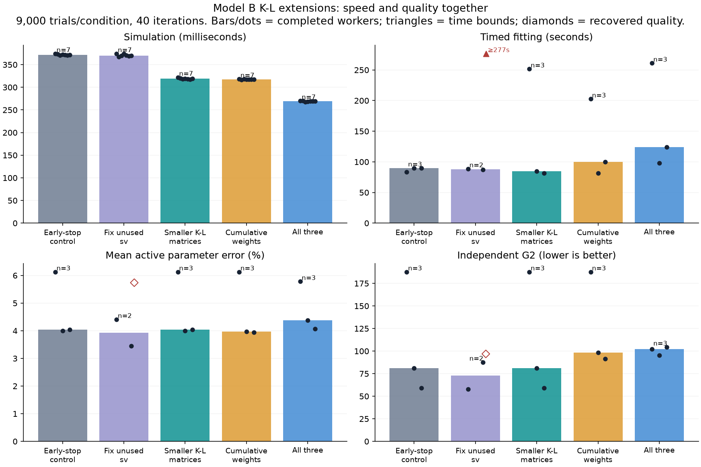

# Model B: testing ideas 3, 4 and 5

**The new ideas made individual simulations faster. They did not establish a
consistent improvement in complete fitting at comparable quality.** All changes
remain optional. This experiment compares against the existing early-stop path;
its speedups are additional to the original legacy comparison.

## What each idea does

| Idea | Simple explanation | Why it might help |
|---|---|---|
| 3: fix unused `sv` | Search 12 active parameters and return the usual 13-value result | Avoid searching a direction that does not change predictions |
| 4: smaller K–L matrices | Keep the same useful modes, with less zero padding | Multiply fewer columns |
| 5: cumulative weights | Add the small random weights first, then reconstruct the fields | Avoid accumulating the large spatial arrays |

```text
Idea 3                       Idea 4
13 search directions         1,325 useful complex modes
        |                             |
Fix the unused direction     Old capacity: 2,000
        |                    New capacity: 1,536
12 directions remain         Same useful modes, less padding

Idea 5
Before: weights → large fields → accumulate fields → check each time step
After:  weights → accumulate weights → large fields → check each time step
```

The cumulative calculation is equivalent in exact arithmetic. Changing fp32
operation order can change rounding and a small number of boundary crossings,
so we checked simulation outputs as well as the algebra.

## Simulation results

The H100 ran 9,000 trials per condition, chunk size 64 and time blocks of 32.
Seven timed calls followed compilation/warm-up and waited for GPU completion.
Distribution checks used six seeds, totaling 108,000 paired trials per variant.

| Variant | Median simulation | Speedup over early-stop control | Timing bootstrap 95% interval |
|---|---:|---:|---:|
| Control | 371.4 ms | 1.00× | — |
| Idea 3 only | 369.7 ms | 1.00× | 0.99–1.01× |
| Idea 4 only | 319.4 ms | 1.16× | 1.16–1.17× |
| Idea 5 only | 317.5 ms | 1.17× | 1.17–1.17× |
| All three | 269.0 ms | 1.38× | 1.37–1.39× |

Idea 3 changes optimization, so a simulation speedup is not expected. All three
together reduced this simulation's runtime by about 27.6%. These timing intervals
describe repeated calls on this machine at these parameters.

Idea 4 retained the same 1,325 complex modes and 99.0039% of the variance. Real
matrix columns fell from 4,000 to 3,072, while random draws kept a common
4,000-column source. Idea 4 matched every paired RT and choice exactly. Ideas
5 and all-three matched 99.9315% of RTs and 99.9537% of choices exactly: 74 RT
differences and 50 choice differences among 108,000 trials. All variants passed
the provisional choice-proportion and RT-quantile screens at this setting.
The new control also matched the saved previous control exactly.



## Complete fitting results

All variants used the identical 9,000-trial observed dataset, three starting
points within ±10% of the truth, fitting key 321 and 40 simplex iterations.
Variant order rotated between starts. This is fixed-budget fitting; no fit
converged, so these times do not measure time to convergence.

| Variant | Start 0 | Start 1 | Start 2 | Original quality gate |
|---|---:|---:|---:|---|
| Control | 83.19 s | 90.05 s | 89.80 s | Reference |
| Idea 3 | ≥276.59 s | 88.67 s | 87.35 s | Failed at start 2 |
| Idea 4 | 251.52 s | 84.47 s | 81.26 s | Passed all three |
| Idea 5 | 202.55 s | 81.33 s | 99.80 s | Failed at starts 1 and 2 |
| All three | 261.11 s | 98.30 s | 123.86 s | Failed at starts 1 and 2 |

Idea 4's median fit speedup was 1.06×, with a paired-start bootstrap interval of
0.33–1.11×. Its fitted parameters matched the control for all starts. The slow
start-0 case prevents a reliable whole-fit speedup claim. The profiles identify
basis rebuilding as an investigation target, but do not establish the cause of
these individual slow cases.

The idea-3 start-0 worker timed out after completing its optimization, before
saving its final score. We replayed all 79 logged losses with the experiment's
exact NumPy/SciPy versions. Replay reproduced four completed control/variant
parameter vectors bit for bit. Its recovered parameters were then scored on the
H100. **The original timeout record is preserved, and the exact fitting duration
is unavailable.** The chart uses a triangle for its time bound and diamonds for
recovered quality; its timing bar uses only the two completed workers.

The original gate permits at most +2 percentage points of mean active parameter
error and +10% independent legacy-path G² for every start. For example, idea 3's
start-2 G² was 87.75 versus control 59.07. Lower G² is better. Removing a useless
coordinate changes the simplex trajectory; it need not improve a short search.

## Scores across more random seeds

We retained the original seed-999 gate and added five held-out scoring keys
5001–5005 without changing any fitted parameters. Mean G² across all six keys:

| Variant | Start 0 | Start 1 | Start 2 |
|---|---:|---:|---:|
| Control | 170.62 | 72.89 | 70.42 |
| Idea 3 | 113.35 | 83.07 | 72.10 |
| Idea 4 | 170.62 | 72.89 | 70.42 |
| Idea 5 | 170.62 | 102.61 | 88.20 |
| All three | 118.97 | 81.56 | 93.98 |

These diagnostics show sensitivity to starting points and scoring randomness.
They do not replace the original gate. There are 90 score records for the 15
fits. The additional pass completed 70 records using 50 actual scorer calls;
identical full parameter vectors on the same data/key reused exactly the same
score within that pass. Six separate calls scored the recovered fit.

## What to use next

Smaller K–L matrices are the clearest simulation-only candidate: they preserved
the tested outputs exactly and improved warmed simulation speed. Cumulative
weights merit broader numerical/recovery checks. The active-parameter search
needs longer fitting studies. Keep the options separate so we can identify what
helps. The learned starting guess is a sixth idea and was not tested here.

The [complete plan](../../plans/2026-10-13-model-b-extension-tests.md) explains
the progression from correctness to timing to recovery and profiling. The
[profiling report](../../plans/2026-10-13-python-profiling.md) covers cProfile and
line_profiler findings at small and production trial counts.

## Reproduce and inspect

Simulation/fitting source: `5e633c26e65a3d7f251885eef8d81973c1a68a9d`.
One H100 SXM 80 GB; Python 3.12.3, JAX/jaxlib 0.10.2, NumPy 2.5.4,
SciPy 1.18.1, default matrix precision and x64 enabled. Model B's fields use
fp32 and RTs use fp64. The FFT path was not tested. Synthetic data and near-truth
starts do not establish human-data recovery or global equivalence.

The extension run recorded 20 cases: five simulator workers, 14 complete fit
workers and one timed-out worker whose finished optimizer was recovered.
Focused verification passed 32 H100 tests, including retained-mode/covariance,
every-step crossing and active-parameter-interface checks, plus 29 CPU tests.

With the backed-up baseline data, a fresh output directory and an external
shutdown deadline, the main experiment can be repeated with:

```bash
python scripts/benchmark_model_b_extensions.py \
  --data-source .benchmark-results/h100-full-budget/data-b.npz \
  --output .benchmark-results/extensions-repeat \
  --nsim 9000 --sim-seeds 6 --timing-repeats 7 --recovery-seeds 3 \
  --fit-iters 40 --budget-seconds 2400 --worker-timeout 300
```

Compact [CSV/JSON results](extensions/summary.json), individual scoring records
and [raw archives with hashes](raw/README.md) are preserved on our own branch.
The pod stopped after about 2 hours 53 minutes; all artifacts were downloaded
before shutdown.
