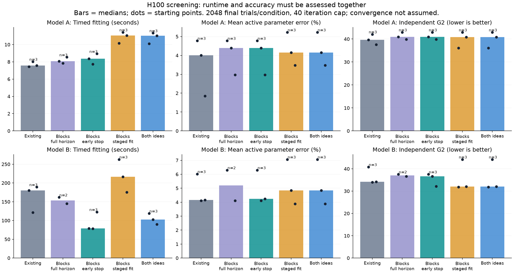
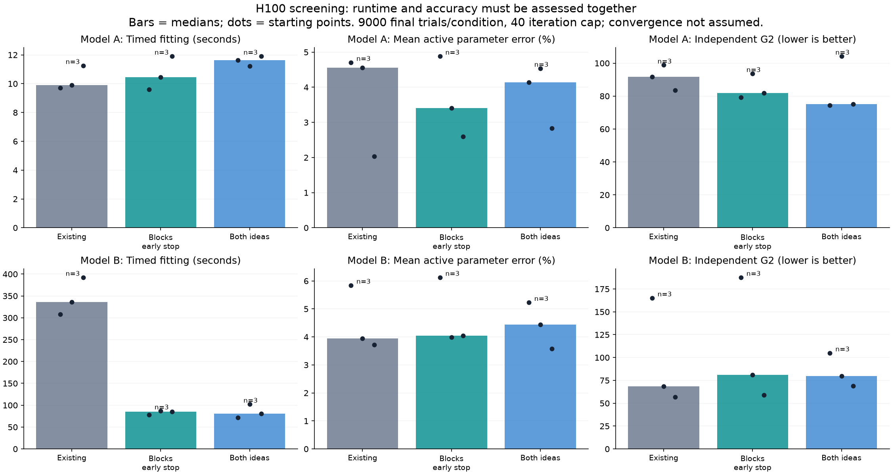
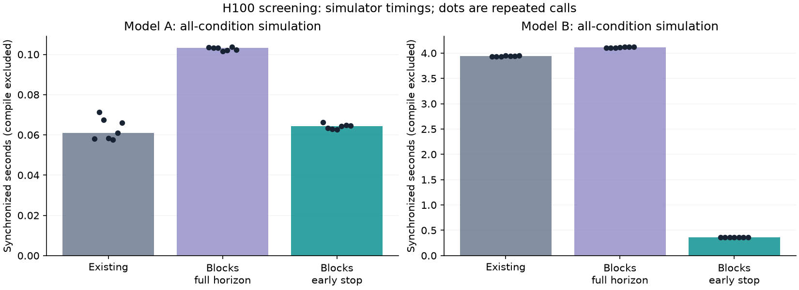

# H100 speedup experiment — October 13, 2026

The two proposed changes are implemented as optional paths. **Model B's
simulation is about 10.9× faster with early stopping** at the tested parameters.
Fitting results depend on trial budget: the 2,048-trial pilot favors early
stopping alone; the completed 9,000-trial pass shows large timing gains but
mixed accuracy. Model A showed no clear runtime improvement. Ideas 3–5 are
also implemented and tested: together they gave a further 1.38× simulator
speedup, with mixed fitting results. See the
[extension report](EXTENSION_RESULTS.md) and
[complete testing plan](../../plans/2026-10-13-model-b-extension-tests.md).

The pod was stopped at **18:14:36 UTC**, about **2 hours 53 minutes** after
deployment, within the authorized three-hour limit. Results were downloaded
before shutdown. Compact results and the
[compressed raw backups](raw/README.md) are preserved on our own GitHub branch.

## What changed

```text
Idea 1: stop spending work on trials that already answered

Simulate a short block → Check every step for a decision
                              |
                         Trial finished?
                         /           \
                       yes            no
                   Save answer    Continue next block
```

Unfinished trials are packed into smaller GPU batches. The code still checks
every time step inside each block; it cannot miss a crossing between block
endpoints. Indexed random keys keep earlier trials fixed when the trial budget
increases. A full-horizon blocked control uses the same random inputs.

```text
Idea 2: spend fewer trials on the early search

Small trial budget → Medium budget → Full requested budget
        Carry the proposed parameters forward at each arrow
        Restart the simplex and recompute losses at each stage
```

The final stage performs real optimization at the full budget. Restarting also
costs extra objective evaluations, which can outweigh the saved simulations.

## Completed pilot: 2,048 final trials per condition

Synthetic observed data used 1,024 trials per condition. Each variant used the
same three starting points, seeds and a total 40-iteration budget. Times below
exclude initial compilation/warm-up; every GPU result was synchronized.

| Model | Legacy median fit | Early stopping | Both ideas | Early-stop speedup |
|---|---:|---:|---:|---:|
| A | 7.58 s | 8.36 s | 11.02 s | 0.91× |
| B, K–L | 179.98 s | 79.17 s | 102.41 s | 2.27× |

Model B's early-stop speedup interval was 1.54–2.27× in a paired bootstrap of
these three starts. This is a small screening experiment. Early stopping passed
the provisional recovery/loss checks for all three starts. Adding staging did
not: for start 1, independent G² was 44.22 versus 33.97 for legacy and 36.66 for
early stopping alone. Lower G² is better. The combined approach's median
speedup over legacy was 1.76×, but speed alone does not justify adopting it.

First-use costs matter too. Model B's median compilation/warm-up plus timed fit
was 192.60 s for legacy, 98.23 s for early stopping and 123.55 s for both ideas.
For Model A those totals were 14.20, 19.84 and 37.05 s respectively.



The pilot completed 37 of 38 cases. The third Model B full-horizon blocked fit
timed out; comparisons against that control therefore use only two paired
starts. All legacy/early-stop/combined fitting starts completed. No pilot fit
converged within 40 iterations. These measurements are not time-to-convergence.

The pilot simulator timer included extra work-counter waits for blocked
variants. Its simulator timings are retained for provenance and superseded by
the corrected larger-pass timer. Fitting timings did not use those waits.

## Larger fitting pass: 9,000 final trials per condition

All 26 cases completed, including three paired starts for every fitting variant.
Synthetic observed data and final simulation counts are both 9,000 per
condition. The staged schedule is 512 → 2,000 → 9,000 trials, with 10/10/20
iterations.

| Model | Legacy median fit | Early stopping | Both ideas | Early-stop speedup | Both-ideas speedup |
|---|---:|---:|---:|---:|---:|
| A | 9.90 s | 10.45 s | 11.63 s | 0.95× | 0.85× |
| B, K–L | 335.60 s | 85.30 s | 80.87 s | 3.93× | 4.15× |

For B, compilation/warm-up plus timed fit medians were 351.01/98.85/102.12 s.
Thus the combined approach's slightly shorter timed median does not mean a
shorter first-use total than early stopping alone. None of these fits converged.

Both B candidates failed the original seed-999 accuracy screen. For start 0,
early stopping gave G²=187.71 versus legacy=165.22. For start 1, early stopping
and combined gave 81.08/79.65 versus legacy=68.32. These exceed the provisional
10% margin despite comparable mean parameter errors.

Five additional scoring seeds completed all 90 evaluations without changing
any fitted parameters. Averaging the original and five extra scores gives:

| B starting point | Legacy mean G² | Early-stop mean G² | Combined mean G² |
|---|---:|---:|---:|
| 0 | 131.03 | 170.62 | 100.09 |
| 1 | 75.05 | 72.89 | 73.38 |
| 2 | 68.94 | 70.42 | 67.82 |

The early-stop fit's start-0 penalty persists across scoring seeds. The combined
fits look better on these averaged scores, while their original screen remains
failed. This is a robustness diagnostic, not a replacement criterion or proof
of recovery. Use the full per-seed file to see sampling variation.



## Corrected simulator check: 9,000 trials per condition

Seven timed calls used seed 0 after compilation and warm-up. Distribution
checks pooled seeds 0–11, with 108,000 samples per condition.

| Model | Legacy median | Early-stop median | Speedup | Timing bootstrap 95% interval |
|---|---:|---:|---:|---:|
| A | 0.0609 s | 0.0644 s | 0.95× | 0.90–1.06× |
| B, K–L | 3.9447 s | 0.3618 s | 10.90× | 10.83–10.91× |

Early stopping matched the blocked full-horizon control **exactly** in RT and
choice on all 432,000 Model A trials and 216,000 Model B trials. Allocated
trial-step work fell from 15,335,424 to 1,892,864 for A and from 7,507,968 to
577,536 for B in the recorded final seed. These counts include padding and
represent simulated work, not measured GPU FLOPs.

Model B passed every provisional legacy-versus-early-stop choice and RT
distribution screen. Model A passed RT screens but did not establish the
choice margin for condition index 1/category 3: the proportion difference
was +0.782 percentage points, with a 95% interval of +0.371 to +1.194 points.
The point estimate is inside the one-point margin, but its interval is not.
That leaves this comparison unresolved; it does not justify changing defaults.
These are per-category checks at one parameter setting, not global equivalence.



## What the profilers found

The profiling subagent ran cProfile and line_profiler in a separate H100 window.
All four model/variant cases completed, and summaries matched across ordinary,
function-profile and line-profile passes.

```text
Simplex proposes parameters
          |
          +→ Model B: changed sig? → Rebuild K–L noise basis
          |
          +→ Simulate on GPU
          |
          +→ Compute G² score → Return loss → Next proposal
```

Two useful next experiments are:

1. **Reduce K–L basis rebuilding.** An uncached basis took about 0.84–0.91 s;
   reuse took about 1.2–1.3 ms per call. Changing `sig` triggers new NumPy
   cosine/sine calculations. Test whether reusable spatial terms can be
   separated from the parameter-dependent weights without changing covariance.
2. **Compile the pure G² aggregation together.** Profiles showed repeated JAX
   host operations around scoring. Test a single compiled aggregation against
   the existing loss, with synchronized objective and complete-fit timings.

These profiles used only 128 trials per condition for B and 256 for A. They
identify investigation targets; their fit time shares are not production-budget
shares. A follow-up profiled both models at 9,000 trials per condition, without
fitting. B's two simulation calls took 7.861 s for legacy and 0.727 s for early
stopping; two objective calls took 7.966 and 1.029 s respectively. Its legacy
objective is therefore dominated by simulation. A G² line recording about
8 seconds includes queued GPU work and cannot be read as 8 seconds of pure
aggregation. Objective-related overhead is more visible in accelerated B and A.
Python waits can absorb earlier asynchronous GPU work. Instrumented
durations include overhead and cannot establish speedups. See the
[profiling guide](../../plans/2026-10-13-python-profiling.md) for exact settings,
source lines, commands and limitations.

## Reproducibility and limits

One Secure Cloud H100 SXM, 80 GB HBM3, driver 580.126.09; Python 3.12.3,
JAX/jaxlib/CUDA12 plugin 0.10.2, NumPy 2.5.4, SciPy 1.18.1. Matrix multiplication
precision was `default`; x64 was enabled. Model A uses its existing fp64 path;
Model B uses fp32 spatial fields with fp64 reaction times. Block size 32,
chunks A=256/B=64. Model B's FFT path was not benchmarked here.

Simulator seeds were 0–2 in the pilot, data seed 123, fitting seed 321, and
independent scoring seed 999 at 9,000 trials per condition. Initial parameters
were perturbed within ±10% using start seeds 0–2. The unused `sv` parameter is
excluded from recovery error. Existing fallback behavior and known differences
from the reference Fortran code are retained; no new Fortran parity claim is
made.

Provisional screens allow at most a two-percentage-point increase in mean
active parameter error and a 10% increase in independent G² for **every paired
start**. The original G² gate uses one shared independent scoring seed; it is a
conditional screen. Additional scoring seeds measure variability separately
and do not replace that gate.
Distribution screens use one percentage point for category proportions
and 2% for RT quantiles, with 95% per-category intervals; sparse RT categories
are unscored. These are screening choices, not established scientific
equivalence margins. Synthetic data and near-truth starts do not validate human
data, all parameters, or recovery from distant starts.

The pilot source was `b417244`; the larger runner is `a33b8d3`. Simulation and
fitting source are identical between those commits; reporting/timing/profiling
changes account for the difference. Compact CSV, JSON settings, environment
and screening results are included beside each figure. Raw samples, logs and
profiles have local copies under `.benchmark-results/` and compressed Git
backups in [`raw/`](raw/README.md), with SHA-256 hashes and source commits.
CSV files also retain device allocator peaks where available. Worker peaks
include compilation/warm-up and, for fits, independent scoring; they are not
measurements of peak memory during the timed fit alone.

The implementations remain opt-in; existing simulator and fitting defaults
remain the controls. Focused checks passed: 52 local Python tests, 29 H100
regression tests, and the three follow-up runner tests on the H100 pod. Profiling
CPU smoke checks also completed. The extension commit separately passed 32
focused H100 tests and 29 CPU tests; these overlapping counts are separate runs.

## Repeat the experiment

Install the project's development/fitting dependencies and GPU-enabled JAX as
described in `scripts/run_h100_speedup_validation.sh`. On an H100, with an
external pod shutdown deadline and enough time remaining:

```bash
python scripts/benchmark_speedups.py --output .benchmark-results/h100-repeat \
  --models a,b --fit-variants legacy,early_stop,combined \
  --data-nsim 9000 --final-nsim 9000 --score-nsim 9000 --fit-iters 40 \
  --sim-seeds 12 --timing-repeats 7 --recovery-seeds 3 \
  --budget-seconds 2700 --finish-reserve-seconds 90 --worker-timeout 1100
```

Budget limits may leave cases incomplete. After the benchmark process exits,
repeat held-out scoring without changing the fitted parameters:

```bash
python scripts/score_speedup_robustness.py .benchmark-results/h100-repeat \
  --output .benchmark-results/h100-repeat/score-robustness.json \
  --nsim 9000 --seeds 5001,5002,5003,5004,5005 --budget-seconds 300
```

This keeps the original seed-999 screen and records additional scoring
variability separately. Use a fresh output name each time. CPU smoke checks of
this scoring script completed six evaluations with fp64 enabled; those are
harness checks, not GPU evidence.

Install `matplotlib` to recreate the figures with
`python scripts/plot_speedup_results.py SOURCE --output FIGURE_DIRECTORY`.
Run profiling in its own GPU window using the linked profiling guide. Stopping
a benchmark or profiler process does not stop pod billing.
