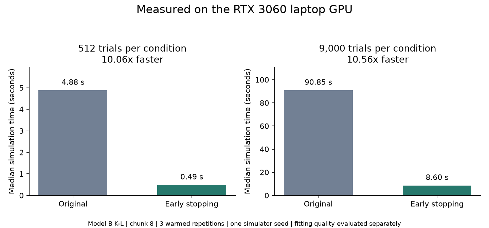
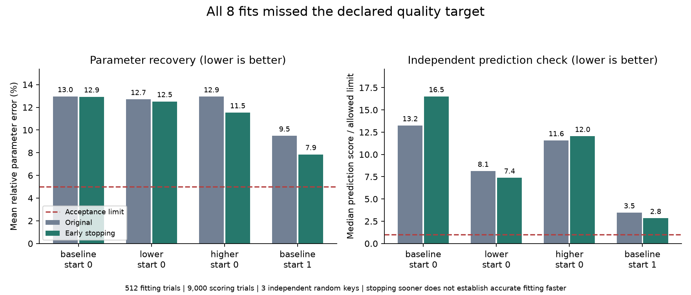

# RTX 3060 validation

Updated 2026-10-14T00:22:41.365193+00:00. **Study finished within budget.**

The 9,000-trial pilot measured **90.85 s -> 8.60 s**, or **10.56x faster simulation**.
This establishes a simulation result for this workload. Fitting to equal quality is a separate question.



| Pilot trials per condition | Original | Early stopping | Speedup |
|---|---:|---:|---:|
| 512 | 4.8816 s | 0.4853 s | 10.06x |
| 9,000 | 90.8538 s | 8.6001 s | 10.56x |

Both pilots used chunk 8, three warmed repetitions and simulator seed 0.
In the 512-trial pilot, early stopping and its full-horizon blocked control produced exactly matching RTs and choices for all 1,024 trials.
The laptop took about 23x longer than the H100 for the 9,000-trial workload; chunk sizes, drivers and CUDA dependencies differed.

The smaller study-128 measured 8.35x/8.16x/7.22x simulation speedups across three settings. Its paired outputs matched exactly across all three simulator seeds. Some category RT screens lacked enough samples; these are unscored checks, not statistical equivalence proof.

The larger 512-trial study measured warmed simulation speedups of **8.94x / 9.76x / 10.78x** for baseline / lower / higher boundaries. Early stopping and its paired full-horizon blocked control matched every choice and RT across **9,216 trials**. This paired check uses the same indexed randomness; the original implementation uses a different random-number layout, so equal root seeds need not produce identical fitting trajectories.

## Six-hour quality study

Six hours total includes prior GPU pilots. Absolute stop: **October 13, 9:00 p.m. Eastern (October 14, 01:00 UTC)**.
The independent guard confirmed no matching benchmark processes remained at 2026-10-14T00:15:02.892193+00:00 (8:15 p.m. Eastern). All 25 planned jobs were recorded, including three time-capped fits. GPU work finished about 5 hours 15 minutes after the first pilot.

```text
Three parameter settings + four paired starts
                    |
         Original vs early stopping
            512 trials for fitting
                    |
      Save estimates and training times
                    |
 Original simulator: 9,000 trials, three new random keys
                    |
       Compare recovery + prediction quality
```

Eight fits used at most 1,000 iterations and a 1,800-second training cap checked after each objective evaluation, allowing a small final-evaluation overshoot. Training times exclude initialization, warm-up and later scoring. All other improvements remained disabled. Observations contain 9,000 trials per condition and were fingerprint-verified before reuse.
The target remains <=5% mean error on effective active parameters AND independent-MC median G2 within the declared true-parameter margin. Score the first eligible saved checkpoint and final estimate, using keys 999/5001/5002. Scoring does not guide fitting. It uses the same observations with independent simulator randomness, not held-out human data.

| Setting / start | Variant | Training minutes | Evaluations / iterations | Fit status | Converged | Recovery error | Target reached |
|---|---|---:|---:|---|---|---:|---|
| baseline / 0 | legacy | 30.08 | 312 / capped/unknown | fit_time_limit | False | 12.96% | False |
| baseline / 0 | early_stop | 9.14 | 462 / 156 | completed | True | 12.93% | False |
| lower_boundary / 0 | legacy | 29.65 | 324 / 55 | completed | True | 12.71% | False |
| lower_boundary / 0 | early_stop | 8.60 | 411 / 121 | completed | True | 12.52% | False |
| higher_boundary / 0 | legacy | 30.02 | 324 / capped/unknown | fit_time_limit | False | 12.94% | False |
| higher_boundary / 0 | early_stop | 7.88 | 470 / 147 | completed | True | 11.54% | False |
| baseline / 1 | early_stop | 10.35 | 515 / 188 | completed | True | 7.85% | False |
| baseline / 1 | legacy | 30.08 | 307 / capped/unknown | fit_time_limit | False | 9.49% | False |

**All eight fits failed both recovery and prediction requirements. No pair has an observed time-to-quality speedup.** Early stopping returned optimizer convergence in 7.88-10.35 training minutes for all four cases. The original returned convergence in one case and hit its approximately 30-minute cap in three. Those are stopping times, not times to an accurate answer.



| Setting / start | Variant | G2 at key 999 | Key 5001 | Key 5002 | Median | Allowed median |
|---|---|---:|---:|---:|---:|---:|
| baseline / 0 | legacy | 749.41 | 729.27 | 797.83 | 749.41 | 56.58 |
| baseline / 0 | early_stop | 890.89 | 973.08 | 934.34 | 934.34 | 56.58 |
| lower_boundary / 0 | legacy | 562.02 | 585.52 | 573.36 | 573.36 | 70.51 |
| lower_boundary / 0 | early_stop | 557.11 | 519.93 | 460.46 | 519.93 | 70.51 |
| higher_boundary / 0 | legacy | 574.51 | 535.51 | 560.57 | 560.57 | 48.46 |
| higher_boundary / 0 | early_stop | 583.82 | 584.74 | 565.30 | 583.82 | 48.46 |
| baseline / 1 | early_stop | 160.62 | 163.89 | 140.43 | 160.62 | 56.58 |
| baseline / 1 | legacy | 198.12 | 196.20 | 187.49 | 196.20 | 56.58 |

Lower G2 is better. The median true-parameter scores were 50.53 / 63.19 / 43.14 for baseline / lower / higher boundaries. Early stopping had a lower independent median in two paired cases and a higher median in two; all were above their acceptance limits.

The shared first starting guess was 13.05% from truth in each setting. Final early-stop errors were 12.93%, 12.52% and 11.54%; original errors were 12.96%, 12.71% and 12.94%. The second baseline start began at 8.69% error and ended at 7.85% with early stopping and 9.49% with the original. A lower training mismatch can coexist with poor parameter recovery.
The fitter minimizes simulated prediction mismatch; it does not minimize distance from the true parameter vector. Fixed random keys make the Monte Carlo objective repeatable, but its discrete choices and RT-bin comparisons can still produce plateaus. The data support testing the fitting strategy and simulation trial budget next; they do not identify a single cause of failed recovery.

| Paired setting / start | Observed time-to-quality ratio (original / early stop) |
|---|---|
| baseline / 0 | Not estimable: both target hits have not been verified |
| lower_boundary / 0 | Not estimable: both target hits have not been verified |
| higher_boundary / 0 | Not estimable: both target hits have not been verified |
| baseline / 1 | Not estimable: both target hits have not been verified |

A time limit or iteration limit is not convergence. A missing target hit is censored, not a speedup estimate. Training time to a scored target excludes later diagnostic scoring and warm-up, and is an upper bound at coarse saved checkpoints.
This is a small synthetic study on one laptop. It does not settle all parameter settings, human-data validity, or fitting with 9,000 training trials.

## Reproducibility and backup

[Plan](../../plans/2026-10-13-rtx3060-early-stop-validation.md), [compact evidence](evidence.json), [audit](audit.json), [archive/file SHA-256 manifest](raw/manifest.json). Raw archives retain settings, source snapshots, samples, logs, traces, the audit program and completed/partial results.
GPU JAX 0.10.2, NumPy 2.5.4, SciPy 1.18.1; x64 enabled, fp32 fields/fp64 RT; reduced basis cache 2 for both variants. Allocator limit 3 GiB on the 6 GiB GPU. Library defaults were unchanged.
Before the study, 17 focused GPU tests passed; seven driver/guard tests passed after the scheduling changes, and the guard stopped its live smoke process.
The H100 pod remains stopped. The offered $3.48 RunPod balance is reserved for a focused follow-up if needed.
