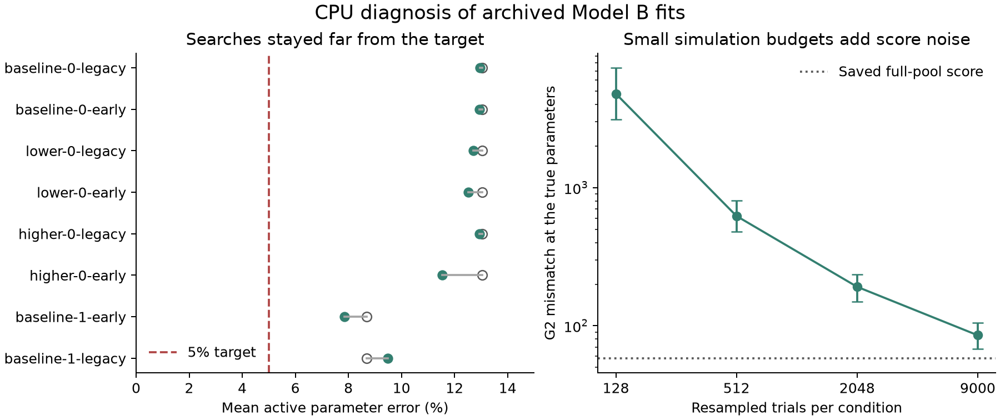
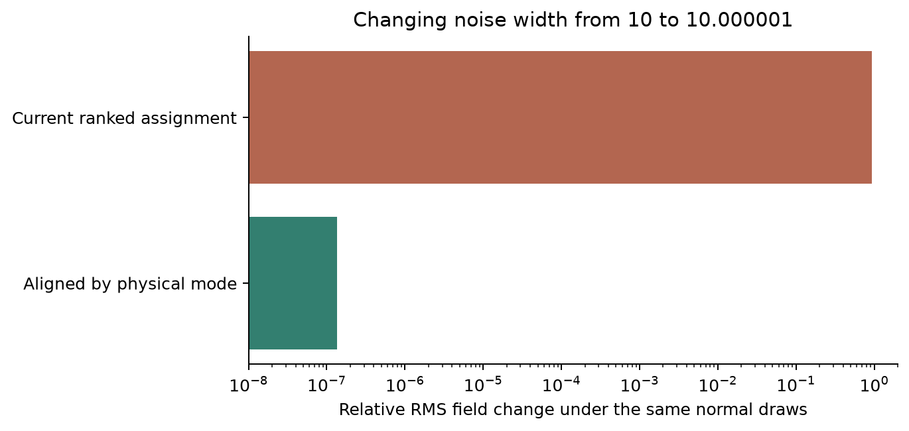

# Why the Model B laptop fits missed the accuracy target

15 October 2026. CPU forensic investigation of the preserved RTX 3060 study. **No new GPU run or cloud spending.**

The immediate failure was a search that stalled far from the true parameters. All five fits reported as converged had collapsed onto flat objective patches; the other three reached their time caps. We also reproduced a K–L noise-assignment discontinuity and measured substantial score noise at the small fitting budget. These findings explain why optimizer convergence was insufficient. They do **not** establish how much each mechanism contributed to each failed fit, or prove that a proposed repair will achieve 5% recovery.

There is no established RTX 3060 hardware fault in this evidence. The K–L mechanism reproduces on CPU and exists in the original implementation, before improvement 1.

## The earlier successful example started much closer

The June benchmark used `np.random.seed(0)` and a uniform ±10% perturbation. Reconstructing that exact start gives **3.324% mean error over the twelve active parameters**. It was already below today's 5% mean-error threshold before fitting. Its reported final error was 2.98%.

The laptop benchmark used a different random generator, ±20% perturbations, and starts at **13.048%** and **8.688%** error. Start 0 reused the same relative perturbation for all three true parameter settings. These were four paired starting cases, not eight independently sampled starts.

| Setting | June K–L example | October laptop study |
|---|---:|---:|
| Starting mean active parameter error | 3.324% | 13.048% or 8.688% |
| Simulated trials per condition during optimization | 9,000 | 512 |
| Observed synthetic trials per condition | 1,024 | 9,000 |
| Maximum simplex iterations | 100 | 1,000 |
| Coordinate and loss stopping tolerance | 0.0000001 | 0.00001 |
| Final recovery | 2.98% in one example | 7.85–12.96% across eight fits |

Thus the laptop results are not a matched regression of the June recovery experiment. June demonstrated a useful close-start example, not reliable recovery from the more distant October starts. Neither experiment proves broad identifiability or universal recovery.

Sources: [June runner](../../../scripts/h100_stage6_kl_benchmark.py), [historical completion note](../../notes/2026-06-05-stage-6-completion.md), [reconstructed starting guess](historical-start.json).

## What the saved optimizer paths prove

We replayed **all 3,125 recorded evaluations** through the actual `shared.staged_fit.minimize_staged` wrapper using their archived loss values. Every requested parameter vector, evaluation count and completed returned estimate matched exactly. Time-capped cases replayed to their recorded interruption. This is optimizer replay, not another simulator run or a cross-device simulator equivalence test.

All five converged fits ended with:

- A maximum coordinate span below the configured 0.00001 stopping tolerance.
- **Exactly zero loss spread across every vertex of the final simplex.**
- Mean parameter error still above 5%.

For example, the lower-boundary early-stop fit converged after 411 evaluations at **12.518% error**. Its last strict improvement was at evaluation 199. Sixty evaluations returned its final loss exactly. The baseline early-stop fit ended at 12.930% from a 13.048% start, despite substantially reducing its training mismatch.

The stopping rule worked as implemented: the search simplex became tiny and its scores stopped changing. It has no built-in guarantee of correct parameter recovery. Choices, first-crossing times and RT-bin counts make the finite-simulation objective discrete. Tightening the tolerance alone does not repair this landscape.

None of the eight returned vectors changed under the production parameter clamp. The error calculation excludes unused `sv`, so the reported 13% error is not caused by counting that inactive slot. However, the optimizer still searched it: its initial single-coordinate perturbation had exactly the same loss in all eight traces. That is an unnecessary flat direction, not an established sole cause.



Open circles show starts; green circles show returned estimates. The right panel uses the conditional bootstrap described below, with 10th–90th percentile bars. Its score axis is logarithmic.

## A reproducible K–L implementation issue

`model_b/grf_kl.py` sorts Fourier modes by their eigenvalues, then places their basis columns in that ranked order. The simulators generate fixed Gaussian coefficients by **column position**. Nearby noise-width values can reorder tied or nearly tied eigenvalues, causing the same coefficient to multiply a different spatial pattern.

```text
Before the small parameter change       After the rank order changes
random coefficient A → spatial pattern P   coefficient A → pattern Q
random coefficient B → spatial pattern Q   coefficient B → pattern P

Desired for a smoother fitting comparison
coefficient A stays attached to P; coefficient B stays attached to Q
```

This defeats part of the purpose of fixing the random key during fitting: the physical parameter barely changes, but the Monte Carlo realization can change sharply. It does not imply an invalid Gaussian distribution at a fixed parameter value. A permutation of independent normal coefficients preserves that distribution, while changing the coupling between nearby parameter evaluations.

We checked the **actual production padded basis** on the 100 × 160 grid. At noise width 10 versus 10.000001:

| Diagnostic | Result |
|---|---:|
| Retained complex modes | Same 1,325 modes |
| Modes still at the same rank | 57.89% |
| Relative eigenvalue-spectrum change | 0.0000200% |
| Expected relative RMS noise change under the same coefficients | 92.90% |
| Expected relative RMS change after aligning coefficients by physical mode | 0.0000136% |

The field calculation used 128 fixed spatial locations. The expected RMS ratio is the Frobenius norm of the basis difference divided by the original basis norm; it integrates over independent unit-normal coefficients. A separate set of 32 fixed normal draws gave a 90.23% realized field difference before alignment and 0.0000250% after alignment. A second nearby-parameter probe around width 11.651022 showed the same mechanism. These are diagnostic field checks, not fitting-success estimates.

The intervention changed **only the assignment of coefficients** for an unchanged retained mode set. The covariance was preserved, within floating-point tolerance. This isolates the assignment mechanism from the intended change in spatial covariance.



The same rank-sorting and six-decimal cache rounding appear in historical commit `b1c7162`, before the early-stopping work. Both original and early-stop K–L simulation use this basis. Increasing GPU speed does not remove the mechanism.

**Repair direction:** tie Gaussian coefficients to stable physical Fourier-mode identifiers, rather than current eigenvalue rank. Handle changing retained sets, conjugate-mode ties, trial IDs and block IDs explicitly. Simply sorting with a stable algorithm or freezing one noise-width value is insufficient. The alignment here is a diagnostic intervention for an unchanged mode set, **not a deployed or fully validated repair**.

## The 512-trial fitting budget adds substantial noise

We resampled the saved original K–L pilot output generated at the true parameters: one 9,000-trial pool per condition, simulator seed 0. Each of 128 bootstrap replicates at each trial budget was scored against the preserved 9,000-trial observations using the production `condition_g2_b` function. The bootstrap seed was 766.

| Resampled trials per condition | Median G2 | 10th–90th percentile |
|---|---:|---:|
| 128 | 4,792.97 | 3,120.97–7,387.12 |
| 512 | 623.69 | 479.45–803.58 |
| 2,048 | 191.46 | 148.80–235.83 |
| 9,000 | 85.32 | 68.00–105.19 |

The saved full-pool score without resampling was 58.15. These results are conditional on one pool, not new independent simulator seeds. In particular, resampling the 9,000-trial pool adds another sampling layer, so its median is not an estimate of the exact independent 9,000-trial objective distribution.

The controlled comparison establishes that fewer simulated trials add substantial bias and variability to this mismatch score, even at the true parameters. The number 623.69 is **not** the unmeasured training score at truth under fitting key 321. Nor does it mean that more trials alone are proven to fix parameter recovery.

The October 9,000-trial scoring happened only **after** fitting; it did not refine the fitted estimates. Thus the run was not a 9,000-trial fitting validation.

## Findings and remaining uncertainty

| Explanation | What the investigation established |
|---|---|
| Optimizer stall | Verified exactly: five flat final simplexes; three time caps; all eight accuracy failures retained |
| More difficult October starts | Verified: June began at 3.324% mean error; October began at 8.688% or 13.048% |
| Small Monte Carlo fitting budget | Verified increased score noise in controlled resampling; contribution to each failed fit not separately measured |
| K–L rank-dependent noise reassignment | Verified on the production CPU basis; coefficient alignment removes the demonstrated field jump without changing covariance |
| Inactive parameter or bound/reporting error | `sv` wastes a search dimension but is excluded from recovery; final clamping did not change any estimate; exact replay reproduced reported errors |
| RTX 3060 or JAX failure | No supporting failure isolated; CPU reproduces the assignment mechanism. No new matched GPU/CPU full-simulator study was performed |
| Improvement 1 broke recovery | Not established: both original and early-stop paths failed, and both share the K–L issue. Separate paired stopping checks remain valid at their tested parameters |

## What to test next

1. Implement stable mode-indexed randomness as an explicitly versioned experimental option. Add regression checks for unchanged and changing mode sets, covariance, repeatability and matching early-stop/full-horizon controls. Preserve the historical path for comparisons.
2. Compare the original and repaired assignment at identical starts, observations and trial budgets. Remove the inactive search coordinate in a separate controlled comparison. Restart or enlarge the simplex when it stalls instead of treating a small simplex as accuracy.
3. Reproduce the June close-start case, then use the harder October starts. Test fitting budgets such as 512, 2,048 and a final 9,000-trial optimization stage. Scoring alone at 9,000 trials is insufficient.
4. Compare original versus improvement 1 under the same validated fitting configuration. Keep all failures and caps, score with all three independent keys, and report time-to-quality only for verified successful pairs. Agree the recovery/prediction criterion with Dr Ratcliff.

These are proposed follow-up tests; none is represented here as completed. A stable coefficient assignment may improve the objective but does not guarantee identifiable parameters or a successful optimizer. **The approximately elevenfold simulation speedup remains measured; a speedup in accurate fitting remains unproven.**

## Reproduce the diagnosis

```powershell
.venv/Scripts/python.exe scripts/diagnose_model_b_fits.py --probes --publish
```

The full diagnostic command took about nine seconds on this machine. It verifies the raw archive/file hashes, checks every replayed proposal and returned estimate, reconstructs the June starting guess, runs the production-basis intervention and production-objective bootstrap, and writes compact evidence and plots. It never calls the full simulator, starts a GPU benchmark or spends RunPod credit.

To reproduce one historical quality failure as an intentional nonzero exit:

```powershell
.venv/Scripts/python.exe scripts/diagnose_model_b_fits.py --require-quality --case lower_boundary-0-early_stop
```

CPU environment: NumPy 2.4.6, SciPy 1.17.1, JAX 0.10.2; x64 enabled for the model functions. Original GPU NumPy/SciPy versions differed, but **every replayed coordinate matched exactly**. This validates this replay rather than claiming general compatibility across versions.

Evidence: [optimizer replay](replay.json), [mode-assignment probe](mode-order-probe.json), [trial-budget probe](trial-budget-probe.json), [June starting guess](historical-start.json), [original complete laptop report](../2026-10-13-rtx3060/README.md), [raw archive hashes](../2026-10-13-rtx3060/raw/manifest.json). Production simulator and optimizer source were not changed by this investigation.
