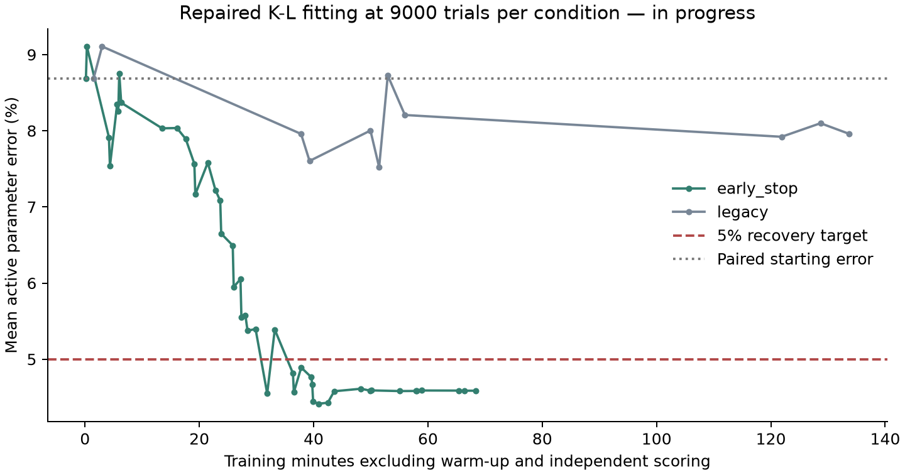

# Repaired K L fitting on the RTX 3060

**In progress. No final fitting-speed or accuracy claim yet.**

Both variants enable the mode-indexed noise repair. Every optimization evaluation uses 9,000 trials per condition. The observed data, 8.688% starting error and ordinary simplex settings are matched; other improvements are off.

GPU preflight passed 10 tests. The production nearby-width field change was 0.000802%; retained component sets identical: True.

Hard stop: **October 15, 2026 at 7:24:24 p.m. Eastern**. This includes setup/pilots and never extends the six-hour allowance.

| Variant | Status | Returned parameter error | Training minutes | Converged | Joint target verified |
|---|---|---:|---:|---|---|
| early_stop | completed | 4.586% | 93.68 | True | None |
| legacy | running_or_pending | Unavailable | Unavailable | Unavailable | None |

The plot follows strict improvements in training loss; recovery error does not guide the optimizer. The actual returned estimate is reported separately because tied losses can select another simplex vertex.

Independent scoring uses the repaired original full-horizon simulator at 9,000 trials for keys 999, 5001 and 5002. A verified joint hit requires at most 5% mean active-parameter error and the predeclared prediction-quality margin. A low error alone, optimizer convergence, or a time cap is not a successful joint hit.

**Time-to-quality ratio is not estimable: both target hits have not been verified.**

This is one paired synthetic case on one laptop. Missing, interrupted and time-capped fits are retained. Scoring uses the same observations with independent simulator randomness, not held-out participant data.

Relative to the earlier 512-trial study, both the noise assignment and optimization trial budget changed. This experiment does not separately estimate how much each change affects recovery.

[Predeclared plan](../../plans/2026-10-15-stable-kl-9000-rtx3060.md) · [Compact evidence](evidence.json)
