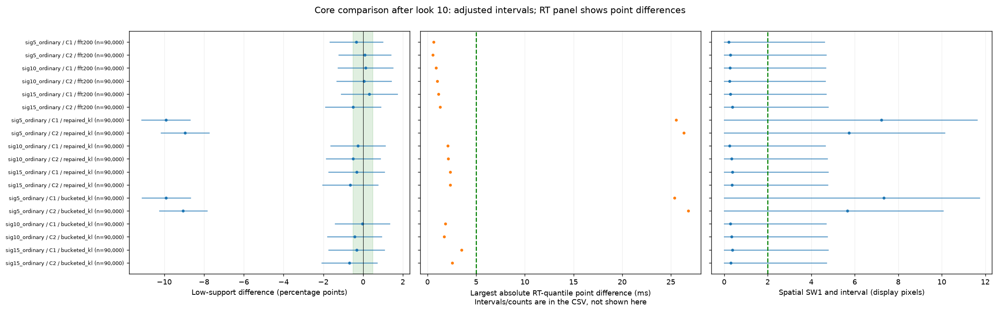
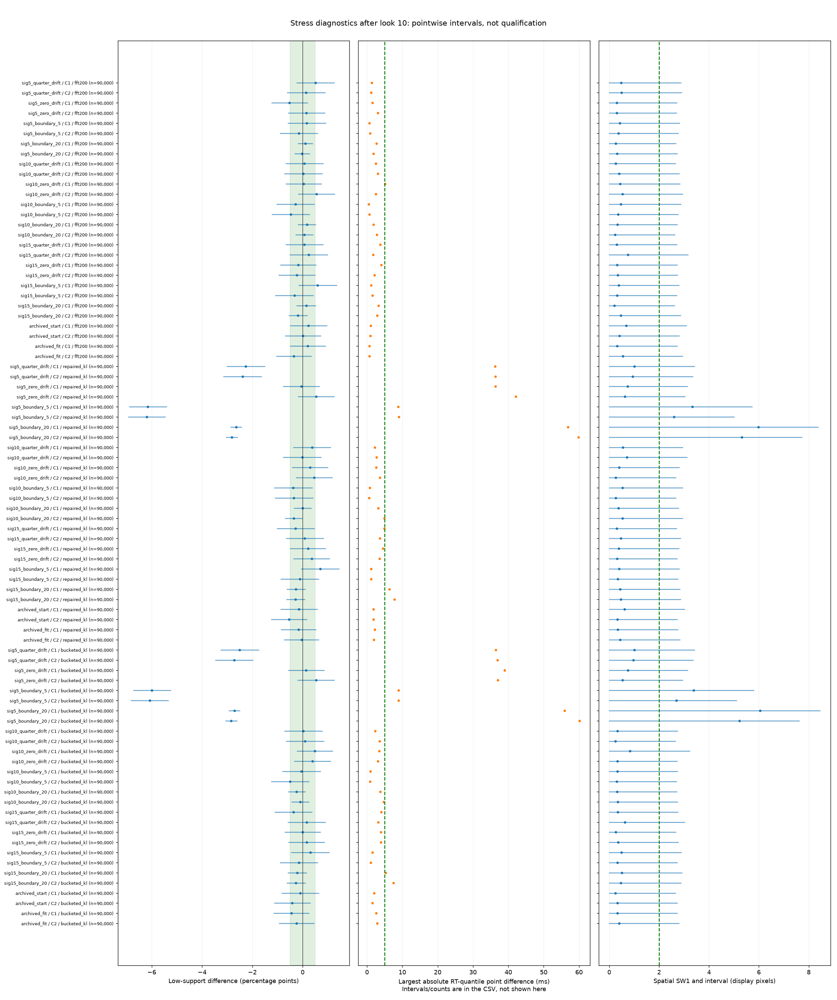
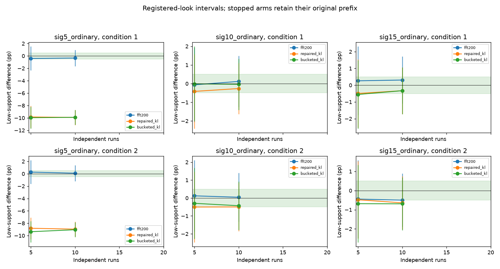

# Behavioral look after 10 independent runs

Up to 90,000 trials per condition and method in each case. Earlier-stopped
candidates retain their frozen reference prefix and original look intervals;
sample counts are explicit. Core intervals adjust for all registered endpoints
and all four scheduled looks. Stress panels are separately labeled diagnostics.
No parameter recovery or fitting is part of this study.

| Method | Case | Condition | Runs | Low-support difference and interval (pp) | Core cell status |
| --- | --- | --- | --- | --- | --- |
| fft200 | sig5_ordinary | 1 | 10 | -0.338 [-1.661, +0.986] | inconclusive |
| fft200 | sig5_ordinary | 2 | 10 | +0.090 [-1.215, +1.395] | inconclusive |
| fft200 | sig10_ordinary | 1 | 10 | +0.119 [-1.253, +1.491] | inconclusive |
| fft200 | sig10_ordinary | 2 | 10 | +0.043 [-1.317, +1.404] | inconclusive |
| fft200 | sig15_ordinary | 1 | 10 | +0.308 [-1.093, +1.708] | inconclusive |
| fft200 | sig15_ordinary | 2 | 10 | -0.500 [-1.887, +0.888] | inconclusive |
| repaired_kl | sig5_ordinary | 1 | 10 | -9.919 [-11.127, -8.707] | material_mismatch |
| repaired_kl | sig5_ordinary | 2 | 10 | -8.954 [-10.149, -7.757] | material_mismatch |
| repaired_kl | sig10_ordinary | 1 | 10 | -0.263 [-1.632, +1.106] | inconclusive |
| repaired_kl | sig10_ordinary | 2 | 10 | -0.498 [-1.854, +0.858] | inconclusive |
| repaired_kl | sig15_ordinary | 1 | 10 | -0.329 [-1.725, +1.067] | inconclusive |
| repaired_kl | sig15_ordinary | 2 | 10 | -0.641 [-2.027, +0.745] | inconclusive |
| bucketed_kl | sig5_ordinary | 1 | 10 | -9.906 [-11.114, -8.694] | material_mismatch |
| bucketed_kl | sig5_ordinary | 2 | 10 | -9.048 [-10.240, -7.852] | material_mismatch |
| bucketed_kl | sig10_ordinary | 1 | 10 | -0.036 [-1.406, +1.335] | inconclusive |
| bucketed_kl | sig10_ordinary | 2 | 10 | -0.430 [-1.786, +0.927] | inconclusive |
| bucketed_kl | sig15_ordinary | 1 | 10 | -0.327 [-1.723, +1.070] | inconclusive |
| bucketed_kl | sig15_ordinary | 2 | 10 | -0.691 [-2.077, +0.695] | inconclusive |

All endpoint values, conditional sample counts and intervals are in [endpoints.csv](endpoints.csv). Maps, region probabilities, conditional RT quantiles and RT CDFs are in `figures/`. Sparse/unbounded intervals remain inconclusive. Maps and point-estimate comparisons alone are not tests of superiority.

