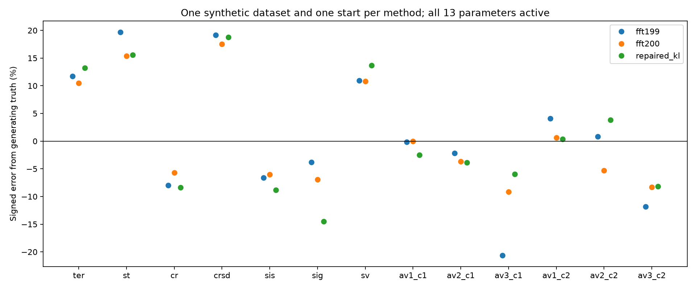
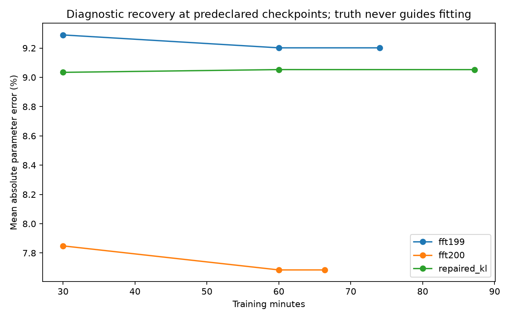

# Recovery and prediction diagnostics

`prediction-differences.json` contains signed region, RT, low-support and
noncrossing differences against truth predictions and the fitted FFT199.
Intervals describe simulation uncertainty conditional on fixed estimates and
the finite reference sample. They exclude dataset and optimizer variability,
are pointwise, and do not certify equivalence. Spatial distances and raw
per-seed summaries are in `results.json`. Missing rare-region values remain
unassessed. All fit failures/caps must be read alongside these plots.
