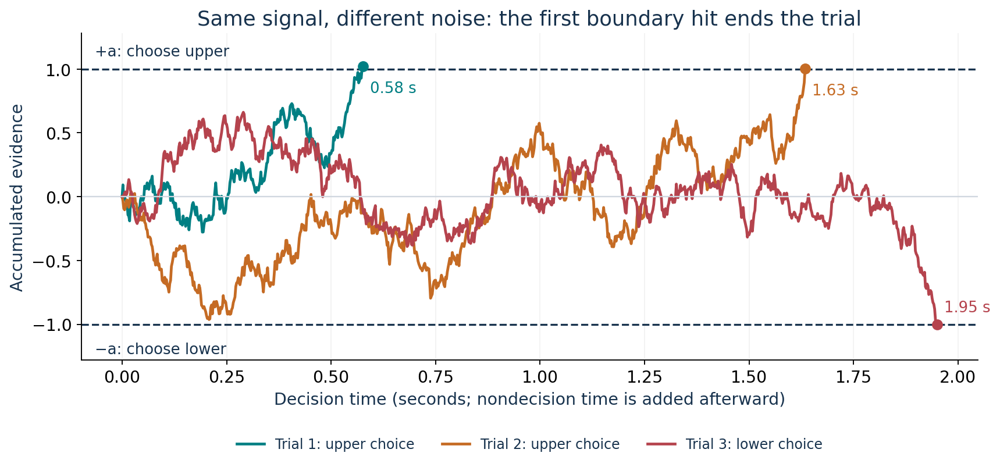
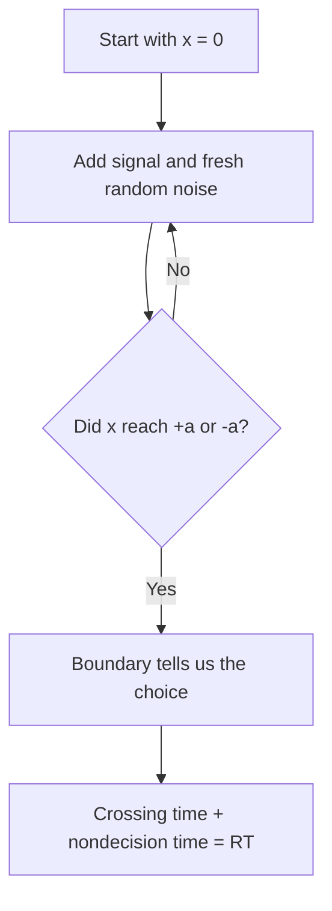
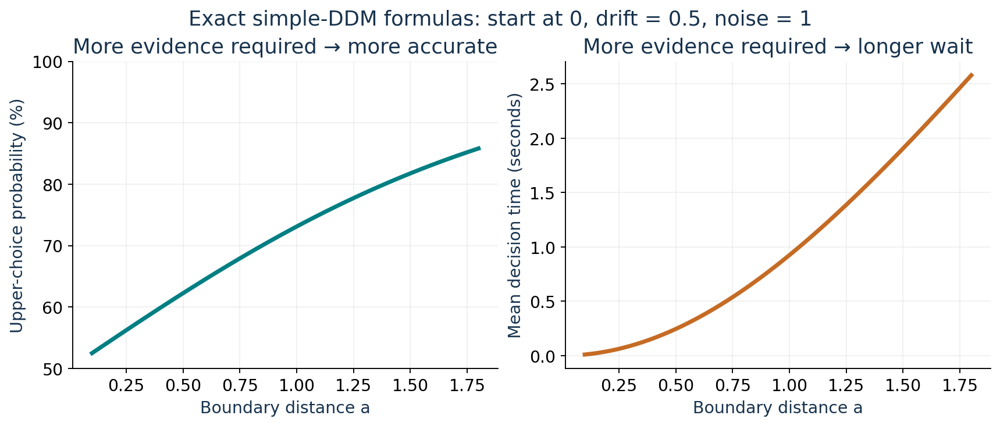
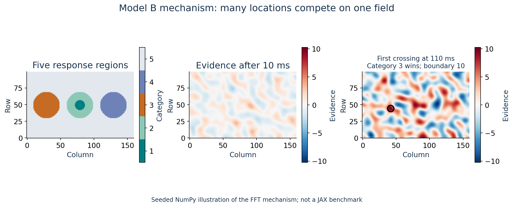
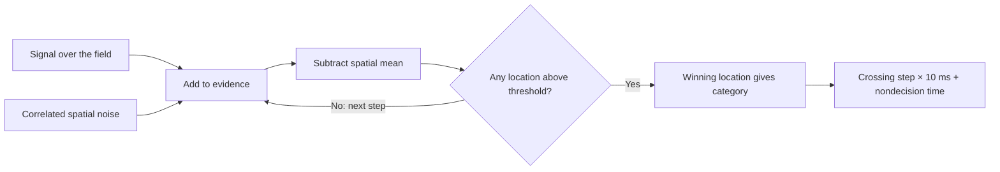
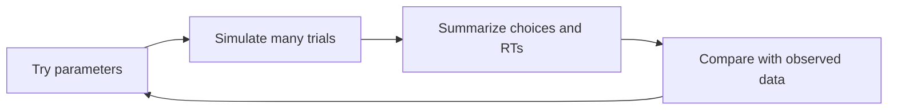

# How a DDM works mathematically

Think of a running score in a tug-of-war. Evidence for one answer pushes the
score upward; evidence for the other pushes it downward. Random fluctuations
make the score wobble. The first decision boundary it reaches ends the trial.

We will build that idea from one update, then connect it to the spatial models
in this repository. Read [the JAX guide](JAX_SPEEDUP_VISUAL_GUIDE.md) afterward.

## 1. The whole model in one picture



All three trials have the same average signal. Their random fluctuations differ,
so they end at different times and can produce different answers. If the signal
favors the upper answer, a lower-boundary hit is an error.

```text
              +a  ─────────────────── choose upper
                   evidence wanders ↗
start x = 0   ────────────────
                   evidence wanders ↘
              −a  ─────────────────── choose lower
```

The model generates **both a choice and the time needed to make it**. This is
the evidence-accumulation account described in
[Ratcliff and McKoon's own introduction](https://u.osu.edu/ratcliffmckoon/the-diffusion-model/).

## 2. What happens during one tiny time step

The simulation updates the score using:

$$
x_{t+\Delta t}=x_t+v\Delta t+\sigma\sqrt{\Delta t}\,\epsilon_t,
\qquad \epsilon_t\sim\mathcal N(0,1).
$$

In ordinary words:

```text
new evidence total = old total + average signal + random fluctuation
```

| Part | Meaning |
|---|---|
| `x_t` | Evidence already accumulated |
| `Δt` | Duration of this step, in seconds |
| `v` | Drift: average evidence gained per second |
| `v × Δt` | Predictable contribution during this step |
| `σ` | Noise strength; this is not the spatial correlation parameter `sig` |
| `ε_t` | A fresh normal random number for each step |
| `σ × √Δt × ε_t` | Unpredictable contribution during this step |

Positive drift favors the upper boundary. Negative drift favors the lower one.
Noise can briefly move the score against the drift.

**Why the square root?** Brownian noise has variance proportional to elapsed
time. Its standard deviation therefore grows as the square root of time.
Using `σ × Δt` instead would make the total noise disappear as you shrink the
simulation step. This scaling is what makes the discretized process approach
the same continuous model.

The continuous-time shorthand is:

$$
dx=v\,dt+\sigma\,dW_t.
$$

`W_t` is Brownian motion: continuous random wandering. The update above is the
computer's small-step approximation to this equation.

## 3. Work through one decision by hand

Use `x = 0`, `v = 0.5`, `σ = 0.2`, `Δt = 0.1 s`, and boundaries at `±0.3`.
These are teaching values, not this repository's fitted parameters.

Each step adds:

$$
0.5(0.1)+0.2\sqrt{0.1}\epsilon_t
\approx 0.05+0.06325\epsilon_t.
$$

| Step | Random number `ε_t` | Amount added | New evidence total |
|---:|---:|---:|---:|
| 1 | +0.5 | +0.0816 | 0.0816 |
| 2 | −1.0 | −0.0132 | 0.0684 |
| 3 | +0.7 | +0.0943 | 0.1626 |
| 4 | +0.2 | +0.0626 | 0.2253 |
| 5 | +1.4 | +0.1385 | **0.3638: crosses +0.3** |

The model chooses the upper answer at `5 × 0.1 = 0.5 seconds`. Notice how step
2 loses evidence even though the average signal is positive.

If seeing the stimulus and executing the response require another `0.2 seconds`:

$$
RT=\text{decision time}+T_{\rm er}=0.5+0.2=0.7\text{ seconds}.
$$

For the ideal continuous process, the stopping rule is:

$$
\tau=\inf\{t:|x_t|\ge a\},\qquad RT=\tau+T_{\rm er}.
$$

`inf` here means “the first time this happens.” A discrete simulation usually
overshoots the boundary slightly, as our example does.



## 4. What the parameters change

| Change | What happens in the simple model |
|---|---|
| Stronger drift toward the correct answer | More correct answers and usually faster decisions |
| Boundaries farther from the starting point | More evidence required: slower, usually more accurate |
| More noise, with the other parameters fixed | Less reliable choices; the RT effect also depends on the setup |
| Starting point closer to one boundary | Bias toward that answer before evidence arrives |
| Larger nondecision time | Adds delay without changing the evidence-based choice |



These curves use a constant positive drift and treat the upper choice as
correct. They are exact formulas for the simple continuous DDM, rather than
measurements from people.

For a start at zero and symmetric boundaries `±a`:

$$
P(\text{upper})=\frac{1}{1+e^{-2va/\sigma^2}},
$$

$$
\mathbb E[\tau]=\frac{a}{v}\tanh\!\left(\frac{av}{\sigma^2}\right)
\quad (v\ne 0).
$$

With zero drift, these become `P(upper) = 0.5` and
`mean decision time = a² / σ²`. The boundary distance in these formulas is
**half** the distance between the two boundaries; some papers use a different
convention for `a`.

You can understand the graph without memorizing the formulas: waiting for more
evidence improves reliability, but costs time.

## 5. How this repository extends the idea

The examples above use **one score and two boundaries**. This repository uses
**many competing scores and a shared upper threshold**:

| Model | Evidence representation | Response categories |
|---|---|---:|
| Ordinary two-choice DDM | One number | 2 |
| Model A | A line of 72 accumulator locations | 3 |
| Model B | A 100 × 160 field: 16,000 locations | 5 |

Here, “1D” in Model A means a spatial line of competing locations. It does not
mean the single-score, two-choice example above.



Each location receives its own signal plus spatially correlated noise. Nearby
fluctuations are related. The location with the largest evidence value at the
first crossing determines the response category.

For one fixed discrete step, write the update as:

$$
A_{k+1}(i)=A_k(i)+D(i)+\eta_k(i)
-\operatorname{mean}_j\!\left[D(j)+\eta_k(j)\right].
$$

`i` labels a location. `D(i)` is its signal increment; `η_k(i)` is its random
noise increment. The mean subtraction centers the field, so positions compete
through their relative evidence. The repository's signal/noise constants are
defined per step; they are not numerically interchangeable with the scalar
example's `v` and `σ`.

Model B's signal contains three Gaussian bumps. Their heights favor different
regions. The noise is a **Gaussian random field**, with covariance specifying
how locations fluctuate together. See [Model B](../../model_b/simulate.py) and
[its noise generator](../../model_b/grf.py).



The current simulators allow up to 400 steps of 10 ms. Trials that never cross
use explicit fallback rules; they do not run forever. This is a finite simulation
of the mathematical process.

## 6. Why simulate thousands of trials?

One trial gives one random outcome. Many trials reveal the model's response
frequencies and reaction-time distributions.

Fitting reverses the question: **which parameters make simulated behavior match
the observed choices and reaction times?**



That repeated simulation is why speeding up the calculation matters. Continue
with [how Gowrish sped it up](JAX_SPEEDUP_VISUAL_GUIDE.md).

The figures are mathematical teaching illustrations. They were generated with
fixed seeds by [make_teaching_visuals.py](../../scripts/make_teaching_visuals.py).
For the broader scientific account, see
[Ratcliff et al. (2016)](https://pmc.ncbi.nlm.nih.gov/articles/PMC4928591/).
