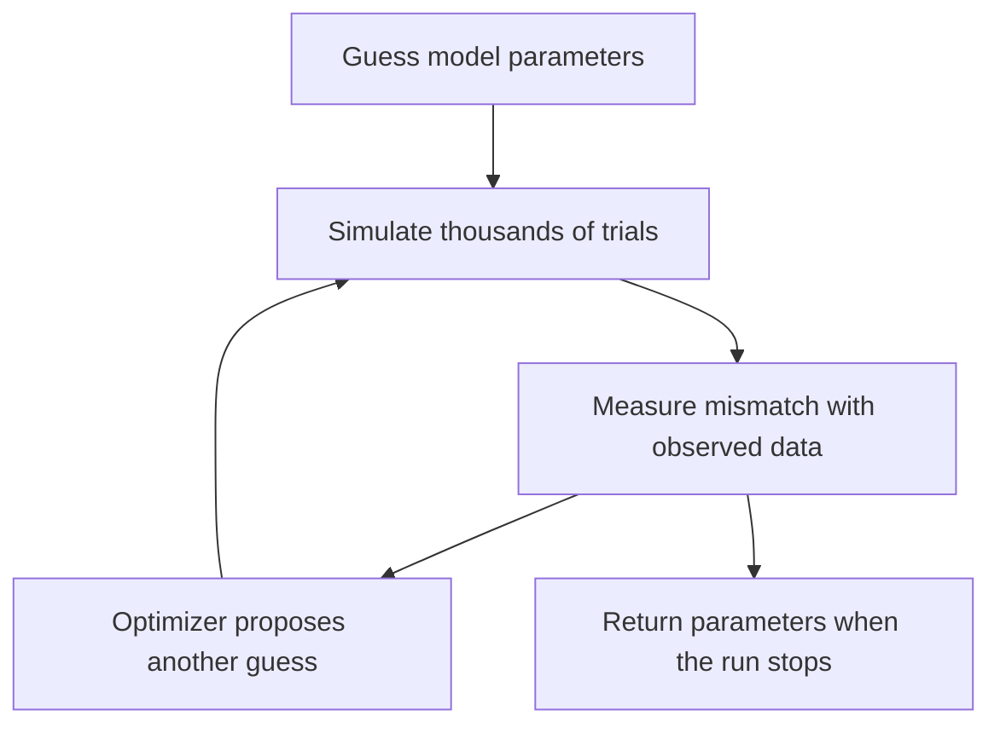
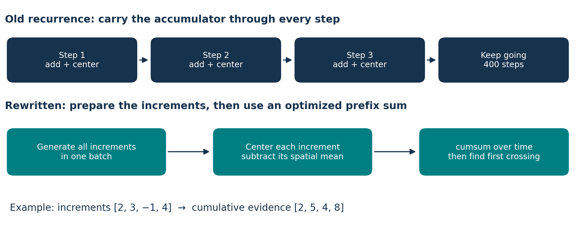
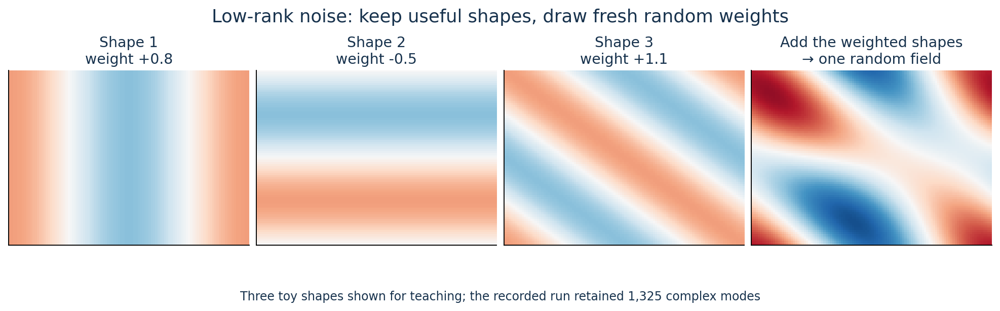
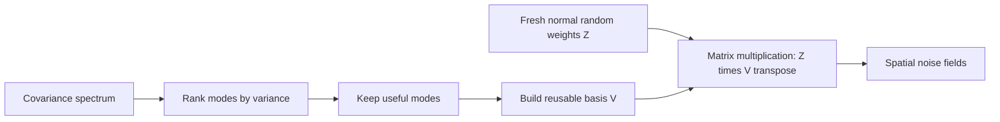
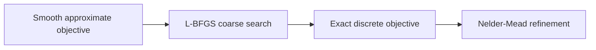
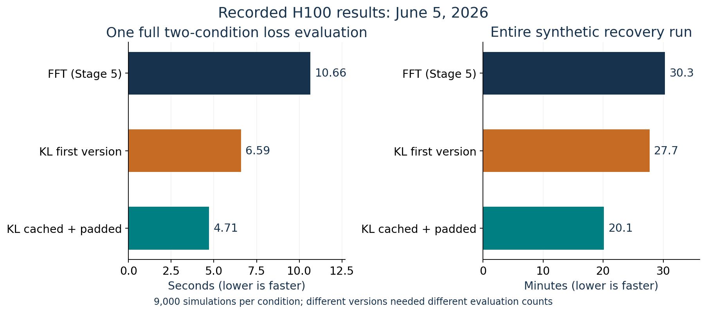

# How Gowrish sped up the Ratcliff models with JAX

Imagine making thousands of pizzas. Changing the recipe into another language
does little by itself. Preparing ingredients together, reusing the preparation,
and using equipment that can handle many pizzas at once changes the workload.

Gowrish's work follows that pattern: **reorganize the simulation into large array
operations, run them on a GPU, and reduce the cost of generating spatial noise**.
The DDM remains the scientific model. The work changes how its predictions are
computed.

Start with [the DDM math guide](DDM_MATH_VISUAL_GUIDE.md) if you want the equations
behind those predictions.

## 1. What was the goal?

Ratcliff's existing Fortran programs simulated choices and reaction times.
Fitting a model meant running those simulations repeatedly while trying
different parameters. The goal was to make that process faster, reproducible,
testable, and accessible through a web app.

Model B is expensive: **16,000 locations × 400 steps × 9,000 trials** is up to
**57.6 billion location-step values for one condition**. The fitting objective
uses two conditions. Even efficient compiled code has a substantial workload.



Making a single simulation cheaper helps every repeated fitting evaluation.

## 2. What JAX contributes

JAX is a numerical computing library. In this project, its useful features are:

| Feature | Plain meaning |
|---|---|
| GPU array operations | Process large blocks of numbers efficiently |
| `jit` | Compile a numerical function and reuse the compiled version |
| `vmap` | Add a batch dimension so one function can process multiple inputs |
| Automatic differentiation | Calculate derivatives when the operations permit it |

The current objective batches the experimental conditions with `vmap`.
`jit` compiles the heavy simulator functions. These are established JAX features,
documented in its [compilation guide](https://docs.jax.dev/en/latest/jit-compilation.html)
and [vectorization guide](https://docs.jax.dev/en/latest/automatic-vectorization.html).

**The key was giving JAX a better-arranged calculation.** Merely translating
the same loop structure would leave much of the original bottleneck intact.

## 3. First change: replace repeated state updates with cumulative sums

The older form repeatedly does this:

```text
new accumulator = old accumulator + signal + noise
subtract its spatial mean
repeat for the next time step
```

Gowrish's optimized form prepares all the signal/noise increments in a batch,
centers each increment, and computes the entire path with `cumsum`.



A cumulative sum means:

```text
increments:       2    3   −1    4
running totals:   2    5    4    8
```

The GPU can use optimized array operations for that calculation instead of
carrying a custom update through every time step. A prefix sum still has work to
do; the gain comes from a better computation structure and batching.

### Why the rewrite preserves the centering rule

Let `P(y) = y − mean(y)`. Centering is linear and applying it twice changes
nothing. If the accumulator starts at zero:

$$
A_k=P(A_{k-1}+\Delta_k)=A_{k-1}+P(\Delta_k).
$$

Therefore:

$$
A_k=\sum_{j=1}^{k}P(\Delta_j).
$$

That is precisely a cumulative sum of centered increments. The identity is
exact mathematically; floating-point ordering and random-number layout can
still differ between implementations.

In [Model A's code](../../model_a/simulate.py), the core is essentially:

```python
noise = z @ L.T                  # correlated noise for all trials and steps
increments = drift + 5.0 * noise
increments -= increments.mean(axis=-1, keepdims=True)
paths = cumsum(increments, axis=1)
```

`L` is a Cholesky factor: multiplying independent noise by it gives the desired
correlations. Matrix multiplication and cumulative summation are established
operations; their arrangement here is the project-specific improvement.

## 4. Second change: batch the 2D noise calculations

Model B needs a new correlated noise field at every time step. Its FFT path
generates a whole batch of fields together, rather than making a separate
custom call at every step. It also uses both the real and imaginary outputs of
a complex FFT to obtain two independent fields.

The port uses 32-bit arithmetic for the large noise and accumulator tensors,
and chunks the trials so memory stays manageable. Reaction-time output is
converted back to 64-bit arithmetic. These are practical compute and memory
choices, not new psychological assumptions.

See [the FFT generator](../../model_b/grf.py) and
[the simulator](../../model_b/simulate.py). The complex-FFT construction is part
of the existing random-field method; its efficient batched use matters here.

## 5. The main algorithm change: low-rank K–L spatial noise

The FFT path was still moving very large arrays through memory. The next change
was to generate noise from a smaller collection of spatial patterns.

Think of a complicated sound as a mixture of waves. Similarly, a random field
can be assembled from spatial patterns with random weights.



The standard mathematical form is:

$$
\eta(i)\approx\sum_{k=1}^{K}\sqrt{\lambda_k}\,z_k\,\phi_k(i).
$$

| Symbol | Plain meaning |
|---|---|
| `φ_k(i)` | A reusable spatial pattern |
| `λ_k` | How much variance that pattern contributes |
| `z_k` | A fresh normal random weight |
| `K` | Number of retained patterns |

This is a truncated **Karhunen–Loève expansion**, or K–L expansion. The method
is established; for example, [this earlier reduced-rank Gaussian-process
paper](https://arxiv.org/abs/2108.05924) uses that representation. Gowrish applied
the method to this simulator and built its fast sampling path.

Because the embedded covariance has Fourier eigenmodes, the implementation can
rank its spectral modes, retain the important ones, and precompute their
cosine/sine patterns. Runtime sampling becomes a large matrix multiplication:

```text
fresh random weights × precomputed patterns = fresh correlated fields
```



At correlation parameter `sig = 10`, the recorded run retained **1,325 complex
modes for 99% of the embedded spectral variance**. Cosine/sine storage uses two
real columns per complex mode. The fitting path pads the basis to a fixed cap
of 2,000 complex modes, or 4,000 real columns.

Every output field still has all **16,000 locations**. The smaller representation
reduces the random input and avoids the repeated large FFT sampling tensors;
it does not shrink the decision field to 1,325 cells. The code folds the spectral
scaling and FFT convention into the basis: [grf_kl.py](../../model_b/grf_kl.py).

**99% variance retained does not mean 99% accurate decisions.** Dropping modes
changes the covariance slightly. Variance, correlation, choices, and RTs need
their own parity checks.

## 6. The fix that made the fitting speed stable

During fitting, changing the noise correlation can change how many modes are
needed. A differently sized basis could force JAX to compile another program.

Two changes helped:

1. **Cache the basis.** Repeated settings reuse the prepared patterns.
2. **Pad to a fixed shape.** Unused columns are zero, so they add no evidence.
   The compiled function sees a consistent array size.

```text
Variable width:   1325 modes → 1410 modes → 1270 modes → changing shapes
Fixed width:      useful modes + zero columns → same shape each time
```

The actual basis values can change while the compiled array program is reused.
This is the reason fixed shapes matter in JAX, not a requirement that every
simulation use identical parameter values.

The first K–L fit took **27.7 minutes**. The cached, padded version took
**20.1 minutes**: about **27% less time** in those recorded runs. This was an
additional implementation improvement after introducing K–L.

## 7. Another experiment: smooth fitting for Model A

Hard decisions such as “first threshold crossing” and “winning category” make
the exact simulation a poor target for ordinary gradient optimization. Small
parameter changes often leave the discrete output unchanged.

The Model A hybrid method uses sigmoid/softmax approximations for a smooth
coarse search, then returns to the exact objective for simplex refinement:



This is a useful optimization aid, but it changes the coarse objective. The
recorded laptop run took about **13 minutes**, with all nine active parameters
within **35%** of their synthetic truth; the original under-one-minute, 15%
target was not achieved. Model B's H100 results below use **Nelder–Mead**,
not this smooth gradient pipeline.
[Source: Model A completion note](../notes/2026-06-05-stage-3-5-completion-summary.md).

## 8. What were the measured results?

These are the repository's recorded **June 5, 2026 H100 runs**, not new benchmarks.
The fitting workload used 9,000 simulations per condition, two conditions, and
a 100-iteration optimizer budget. The timed fit followed an initial compilation
and warm-up evaluation.



| Measurement | FFT version | Cached/padded K–L version | Calculated speedup |
|---|---:|---:|---:|
| One two-condition loss evaluation | 10.66 s | 4.71 s | **2.26×** |
| Entire synthetic recovery run | 30.3 min | 20.1 min | **1.51×** |
| Number of loss evaluations | 171 | 256 | More evaluations in the K–L run |
| Mean active-parameter error | 3.8% | 2.98% | Smaller average error |
| Active parameters within 7% of truth | 12/12 | **10/12** | Two K–L errors exceeded 7% |

The final K–L run reached its iteration limit; its convergence flag was false.
It still gave useful synthetic recovery: the worst reported parameter error
was 9.5%. That is evidence from this recovery example, not a guarantee for every
human dataset. The legacy `sv` slot is unused, leaving **12 active parameters**
in the 13-slot Model B interface.

The faster evaluation did not make the whole fit 2.26× faster because the
optimizer made more evaluations. Approximation and floating-point choices also
mean speed and scientific fidelity must be assessed together.

### Comparing with the original Fortran

| Comparable workload | Recorded/reported Fortran baseline | JAX K–L number | Ratio |
|---|---:|---:|---:|
| One simulator call, six-node MPI | 11 s | approximately 4.7 s | **approximately 2.34×** |
| One simulator call, one node | 36 s | approximately 4.7 s | **approximately 7.66×** |
| Two-condition objective, six-node MPI | approximately 22 s, estimated as `2 × 11` | 4.71 s | **approximately 4.67×** |

Some older summaries call the last ratio “5× per simulator call.” That mixes
the simulator and two-condition objective. The Stage 6 per-call number is also
approximate; the strongest logged measurement here is the **4.71-second full
objective evaluation**.

The original full fits were described as taking “hours and hours”; there is no
precisely timed baseline here for an exact whole-fit speedup. The clear result
is a recorded **20.1-minute synthetic recovery run on one H100**. It supports
faster iteration and larger studies, rather than a universal speed multiplier.

Sources: [Stage 6 completion record](../notes/2026-06-05-stage-6-completion.md),
[raw run excerpt in the handoff](../notes/2026-06-05-session-handoff.md), and
[the benchmark script](../../scripts/h100_stage6_kl_benchmark.py). Seeds were
0 for synthetic data, 1 for fitting noise, and 0 for the ±10% starting perturbation.
Synthetic observations used 1,024 trials per condition. FFT fitting used chunks
of 16 trials; K–L fitting used 64.

## 9. What new thing did he make?

The clearest description is **an accelerated implementation of the spatial DDM**:

- a centered-increment, cumulative-sum simulator;
- batched correlated-noise generation and condition evaluation;
- a truncated Fourier/K–L noise sampler using matrix multiplication;
- cached, fixed-shape bases that avoid repeated compilation;
- a smooth-then-exact fitting path for Model A;
- a web interface for simulation, fitting, and visualization.

DDM, JAX, K–L, FFTs, cumulative sums, L-BFGS, and Nelder–Mead were established
methods. The project contribution is how they were adapted and combined for
these spatial models. Calling it the invention of K–L or a new theory of human
decision-making would misdescribe the work. Commit `b1c7162` records the
cache/padding change under Gowrish's Git author identity.

## 10. What to remember

```text
DDM:       what mathematical process generates choices and RTs?
JAX work:  how can we compute that process much more efficiently?
Web app:   how can a researcher explore it without writing simulation code?
```

The central lesson is to **change the shape of the computation**, then check
that its scientific outputs remain acceptable. A GPU-friendly rewrite can be
slower on a memory-limited laptop; the repository's
[CPU investigation](../notes/2026-06-04-cpu-perf-investigation.md) records that.

The teaching figures can be rebuilt with
[make_teaching_visuals.py](../../scripts/make_teaching_visuals.py). Only the
benchmark chart uses recorded timings; the other figures illustrate mechanisms.
